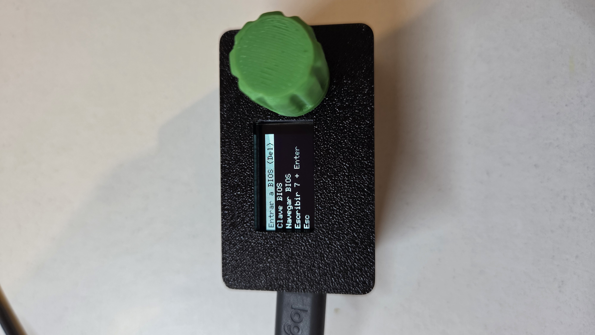

# Miniteclado de macros

Teclado USB mínimo para revisar máquinas con computadoras embebidas: lanza con un solo gesto las secuencias que se repiten al entrar a la BIOS y a la shell UEFI (Delete, contraseña de la BIOS, `fs1:`, `startup.nsh`, contraseña de Windows) y permite moverse por los menús de la BIOS.

## Hardware

- Arduino **Pro Micro** (ATmega32U4, USB HID nativo). El Nano no sirve: no tiene USB nativo.
- Pantalla OLED 0,96" SSD1306 128×64 por I2C.
- Encoder rotativo con pulsador.

| Componente | Pin del Pro Micro |
|---|---|
| OLED SDA / SCK | D2 / D3 |
| Encoder CLK (A) | D4 |
| Encoder DT (B) | D5 |
| Encoder SW | D6 |

## Software

- Arduino IDE, placa **Arduino Leonardo**.
- Librería **U8g2** (olikraus).
- El sketch está en `mini_teclado/mini_teclado.ino`. Cambia `PASS_BIOS` y `PASS_WIN` por tus contraseñas **solo en tu copia local**; no las subas al repositorio.

## Uso

- **Modo macros:** girar elige, un clic envía.
- **Modo "Navegar BIOS":** girar envía flechas, 1 clic Enter, 2 clics cambia el eje (arriba/abajo ↔ izquierda/derecha), pulsación larga vuelve al modo macros.

## Caja impresa en 3D



Carpeta `caja/`, diseñada en [SolidCraft](https://solidcraft.io/) con parámetros editables:

- `Shell.3mf`: tapa superior con las paredes (ventana del OLED, agujero del encoder, recorte USB-C y cuatro postes para tornillos M3).
- `Lid.3mf`: tapa inferior con los avellanados de los tornillos.
- `Miniteclado macros - caja compacta.solidcraft`: el diseño original. Medidas principales: 58 × 34 × 27,5 mm más 2,4 mm de la tapa inferior.

Detalles de montaje:

- El OLED va apilado sobre el Pro Micro con espuma, y el conjunto cuelga de la tapa superior por cuatro clavijas de 1,9 mm.
- Agujero del encoder de 8,6 mm (rosca de unos 8,2 mm) y perilla de unos 18,5 mm de diámetro.
- Tornillos M3 autorroscantes en los cuatro postes; agujero guía de 2,5 mm.
- La altura interior (25 mm) se debe a los pines del Pro Micro sin recortar y a los cables soldados. Si se recortan los pines, el parámetro `inner_h` puede bajar mucho.

## Probador de teclas

`probador_teclas.py` abre una ventana (tkinter) que muestra cada tecla que recibe el Mac, con el tiempo entre teclas y un contador de Delete. Sirve para probar el miniteclado sin una BIOS delante.

```bash
python3 probador_teclas.py
```

En macOS, para que F10 llegue como F10 y no como tecla multimedia, activa "Usar teclas F1, F2, etc. como teclas de función estándar" en Ajustes del Sistema > Teclado > Atajos de teclado > Teclas de función.

## Aviso

Las contraseñas del sketch quedan en texto plano en la memoria flash de la placa y se pueden leer con un programador. No uses aquí contraseñas que valgan en otros sistemas.
